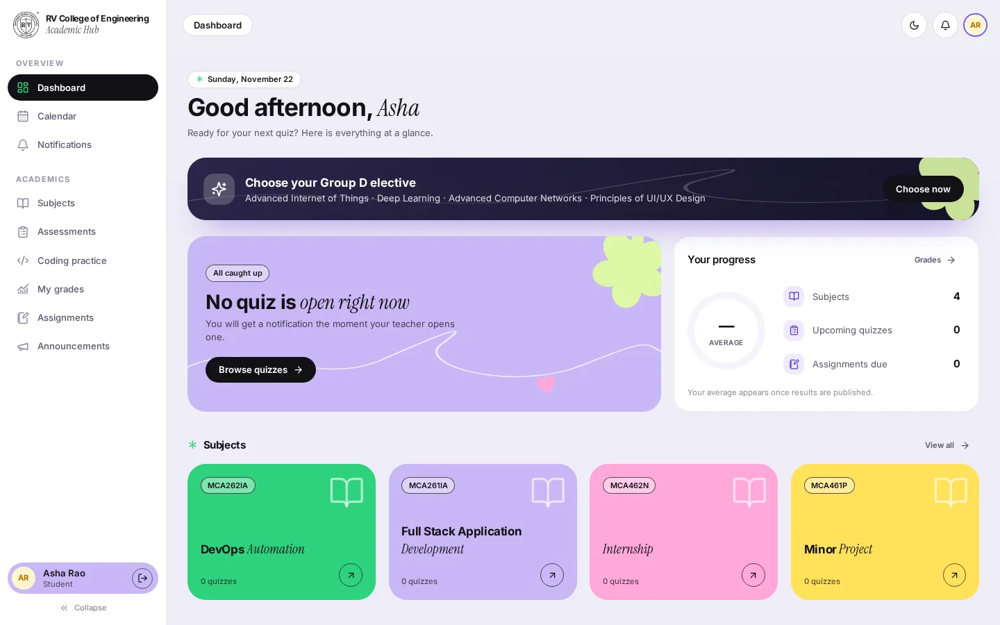
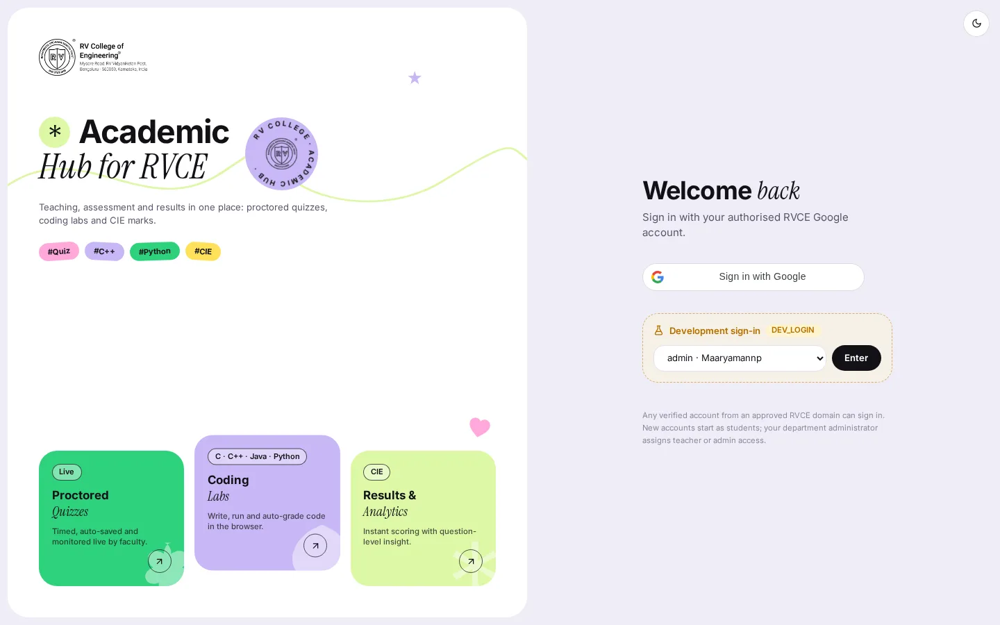
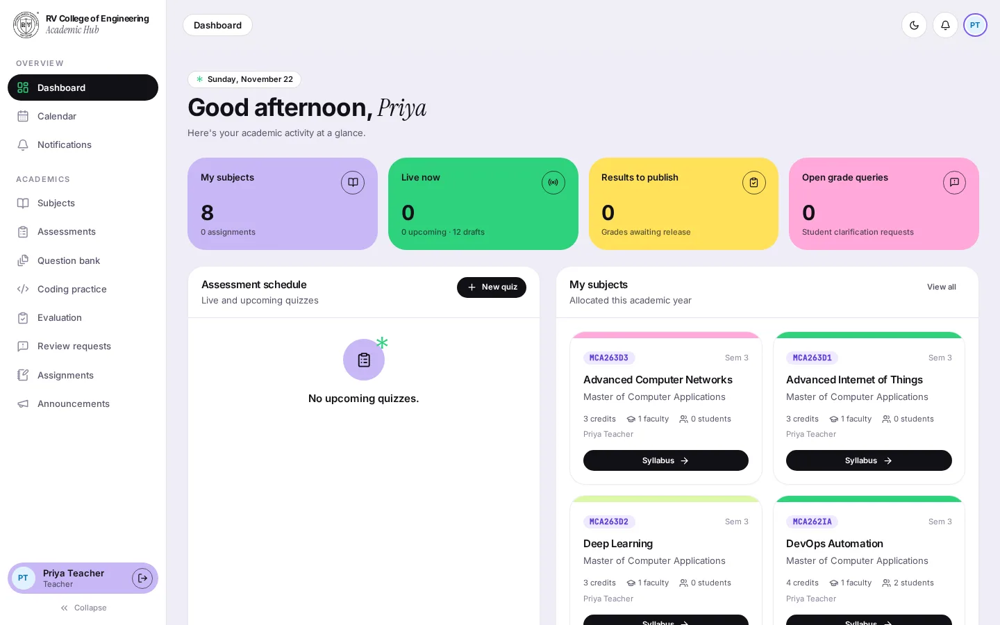
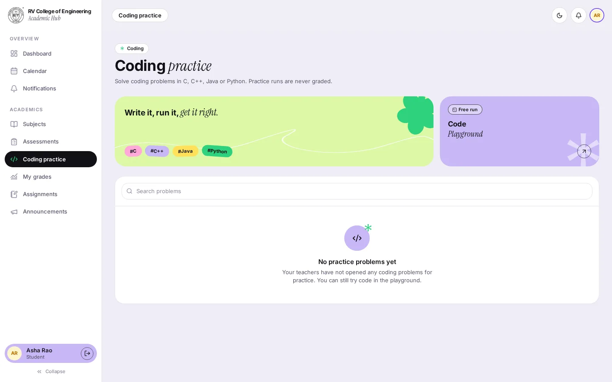
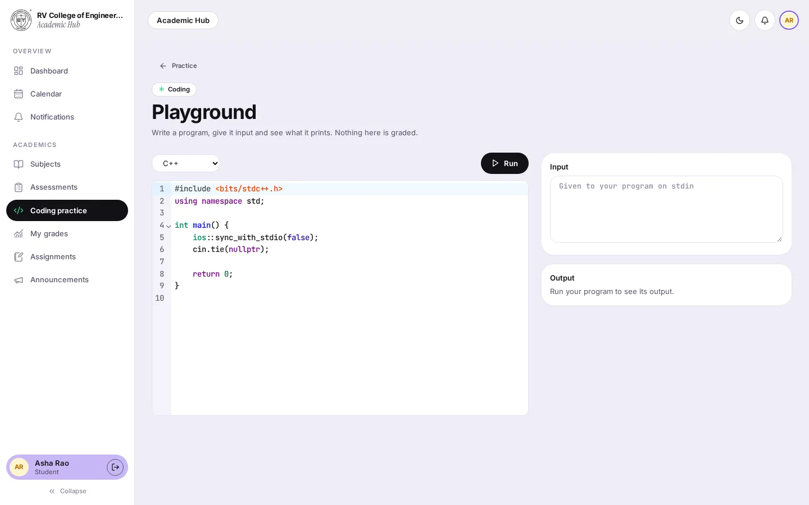
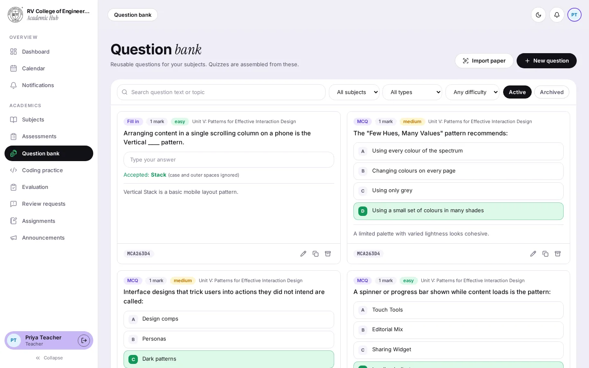
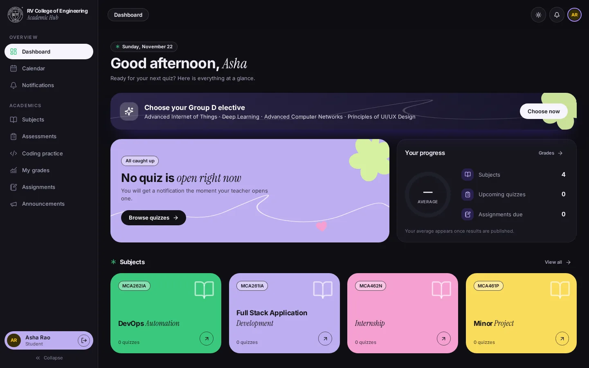

<div align="center">

<picture>
  <source media="(prefers-color-scheme: dark)" srcset="client/public/brand/rv-crest-white.png" />
  
</picture>

# RVCE Academic *Hub*

**Proctored quizzes, coding labs and CIE marks for RV College of Engineering, in one web app.**

[](https://github.com/Kr1szz/FSAD_EL/actions/workflows/ci.yml)




</div>

## Features

| | |
|---|---|
| **Proctored quizzes** | Timed, auto-saved 10-mark quizzes (MCQ and fill-in) with fullscreen, tab-switch and clipboard proctoring, a live teacher monitor, rooms with join codes, and automatic scoring. |
| **Coding labs** | C, C++, Java and Python questions, either HackerRank style (stdin/stdout) or LeetCode style (students write one function; drivers are generated). Sample and hidden test cases, importable from HackerRank zips, `.in`/`.out` files or JSON. A CodeMirror editor, Run / Submit, weighted partial marks, and practice problems with a playground. Code runs in throwaway Docker sandboxes, and the setup was load-tested with 250 concurrent students. |
| **Question bank** | Reusable questions per subject, including importing a whole question paper from a PDF or photo (in-browser OCR). |
| **CIE marks** | Quiz 1, Quiz 2 and the lab test fill the CIE sheet automatically; teachers enter tests and EL, then publish. Excel/CSV exports throughout. |
| **Academics** | Departments, years, semesters, subjects, teacher allocation, elective choice, assignments, announcements, calendar, notifications and grade clarification requests. |
| **Sign-in and roles** | Google sign-in restricted to `rvce.edu.in`. Roles are `admin`, `teacher` and `student`; first-time users become students. |

## Screenshots

| Sign in | Teacher dashboard |
|---|---|
|  |  |
| **Coding practice** | **Playground** |
|  |  |
| **Question bank** | **Dark mode** |
|  |  |

## Quick start

Requirements: **Node.js 20+**, and **MongoDB 7** (`mongod`) or **Docker**. You need Docker to run real code; without it, code runs on a fake judge.

```bash
git clone https://github.com/Kr1szz/FSAD_EL.git && cd FSAD_EL
./run.sh
```

On the first run, `run.sh`:

1. Creates `.env` with a random JWT secret and a local database.
2. Installs dependencies.
3. Starts MongoDB.
4. Loads the MCA semester III data if the database is empty.
5. Builds the code sandbox and starts the code runner.
6. Starts the app on <http://localhost:5173> and the API on <http://localhost:4000/api>.

Press <kbd>Ctrl</kbd>+<kbd>C</kbd> to stop everything.

To sign in with Google, set `GOOGLE_CLIENT_ID` and `VITE_GOOGLE_CLIENT_ID` in `.env`. For local testing without Google, set `DEV_LOGIN=true` to get an account picker on the sign-in page; it is ignored in production.

| Command | What it does |
|---|---|
| `./run.sh` | Set up, start MongoDB and the code runner, seed an empty database, run the API and client |
| `./run.sh seed` | Load the MCA semester III subjects, syllabus, question bank and quiz drafts |
| `./run.sh runner` | Build the sandbox image (`REBUILD=1` to rebuild) and run the code runner |
| `./run.sh test` | Server, client and code runner tests |
| `./run.sh e2e` | Playwright browser tests on a throwaway database |
| `./run.sh build` | Production build of the client |
| `./run.sh stop` | Stop a MongoDB or code runner left running |

Options:

- If the MongoDB Atlas cluster in `.env` is unreachable (for example on a network that blocks port 27017), `run.sh` uses a local MongoDB for that run. Set `LOCAL_DB=1` to always use local, or `DB_FALLBACK=0` to fail instead.
- `RUNNER=0` skips the code runner.

## Project structure

```text
.
├── client/                 React 18 + Vite + Tailwind single-page app
│   ├── public/brand/       RV crest and logo (light and dark), favicons
│   └── src/
│       ├── pages/          Screens by feature (dashboard, assessments, exam, practice, …)
│       ├── components/     ui/ (design system), layout/ (shell, nav), domain/ (quiz, code editor, …)
│       ├── hooks/ lib/     Proctoring, autosave, API client, sockets, OCR and paper parser
│       └── __tests__/      Vitest unit tests
├── server/                 Express + Mongoose API and Socket.IO
│   ├── src/routes/         REST endpoints (assessments, attempts, questions, code, cie, …)
│   ├── src/services/       Grading, attempts, proctoring, CIE, code-run queue and judge clients
│   ├── src/models/         Mongoose schemas
│   ├── src/data/           MCA 2024-scheme semester III data used by the seed
│   ├── src/scripts/        seed, e2e and load-test fixtures
│   └── test/               node --test suites
├── runner/                 Code runner: sandbox image (gcc, g++, JDK 17, Python) + HTTP service
│   └── judge0/             Optional Judge0 setup (needs cgroup v1)
├── e2e/                    Playwright end-to-end tests
├── loadtest/               k6 scenario: 250 students in a coding lab
├── docs/                   Architecture, API, deployment, report, screenshots, reference PDFs
├── run.sh                  One-command local runner
├── Dockerfile              Production image: builds the client, the API serves it
├── docker-compose.yml      MongoDB + app
└── render.yaml             Render blueprint
```

## How it fits together

```text
Browser (React) ──HTTP / Socket.IO──▶ Express API ──▶ MongoDB
                                          │
                                          └─ code-run queue ──HTTP──▶ code runner ──▶ Docker sandbox per submission
```

In production the API also serves the built client, so it is one origin with first-party cookies and no CORS. Code runs on a separate host. See [docs/ARCHITECTURE.md](docs/ARCHITECTURE.md) for the data model, quiz and grading flows and security.

## Testing

| Command | What runs |
|---|---|
| `npm test` | Server unit and HTTP tests: scoring, code grading, CIE rules, proctoring, exports, sign-in, rate limits, route guards |
| `npm run test:client` | Client unit tests (Vitest) |
| `cd runner && npm test` | Real programs in the sandbox: every language, compile/runtime errors, time, memory and output limits, fork bomb, no network |
| `./run.sh e2e` | Playwright: electives, a proctored quiz, exports, mark review, CIE, paper import, and the coding flow from authoring to a graded lab |

The browser tests use a fake judge by default. Set `RUNNER_URL` to run them on real compilers. CI (`.github/workflows/ci.yml`) runs lint, both unit suites, the build and the browser tests on every push and pull request.

## Deployment

The app runs as one service: deploy it on Render with [`render.yaml`](render.yaml), or anywhere with the [`Dockerfile`](Dockerfile). The code runner needs Docker, so it runs on its own VM. See [docs/DEPLOYMENT.md](docs/DEPLOYMENT.md) and [runner/README.md](runner/README.md).

## Documentation

- [Architecture](docs/ARCHITECTURE.md): data model, workflows, security
- [Adding coding questions](docs/QUESTION_FORMAT.md): HackerRank and LeetCode style, test import, JSON format
- [API](docs/API.md): endpoint overview
- [Deployment](docs/DEPLOYMENT.md): Render, Docker, the code runner, operations
- [Code runner](runner/README.md): sandbox design, sizing, tests
- [Development log](docs/DEVELOPMENT_LOG.md) and [plan](docs/DEVELOPMENT_PLAN.md)
- [Project report](docs/report) (LaTeX)

## Contributing

1. Branch from `main`.
2. Keep server-side validation and authorization authoritative; client checks are only for usability.
3. Update tests and docs with behaviour changes.
4. Run `npm run lint`, `./run.sh test` and `./run.sh e2e` before opening a pull request.

Never commit `.env`, OAuth credentials or production secrets.

---

<sub>Built for the MCA Full Stack Application Development (FSAD) course at RV College of Engineering, Bengaluru. The RV name and crest belong to Rashtreeya Sikshana Samithi Trust.</sub>
